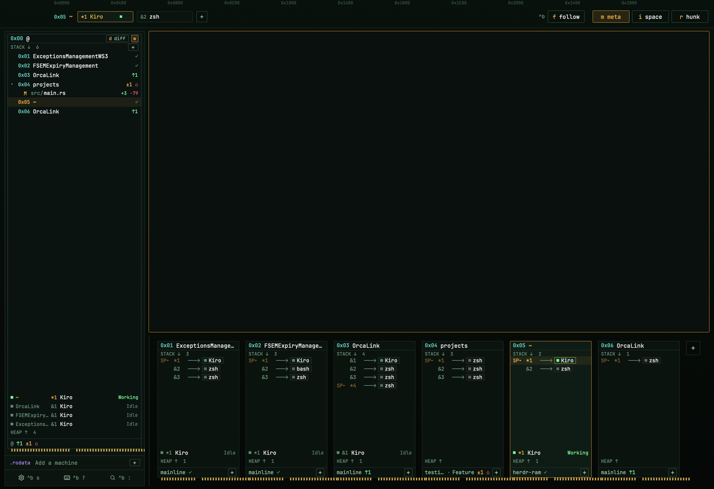
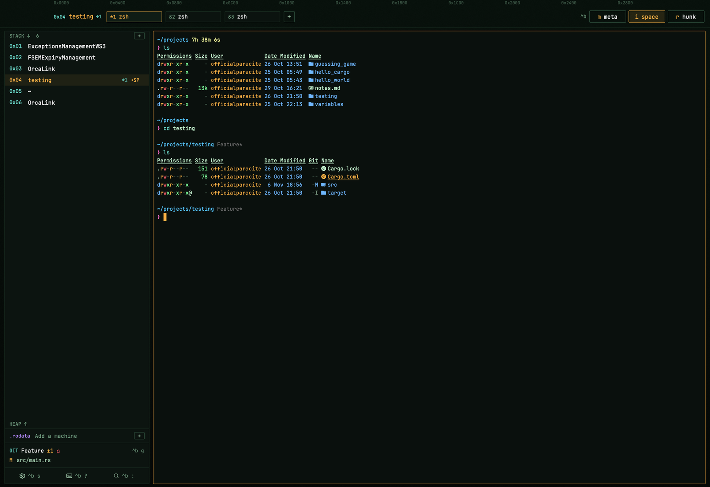
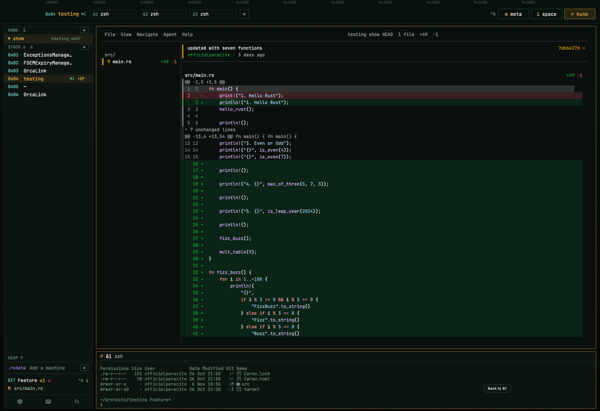

# RAM (private: my own setup)

This is the `private` branch: my exact setup, for my own machines. Its
`install.sh` replaces the keymap, so none of the machine's old keybinds stay.
The `main` branch is the package for other people: it adds only the keys RAM
needs, next to theirs, and follows Herdr's rules for shared layouts.

A Herdr layout for working on many projects at once. Each space is one project
(a repo with its agents and terminals), drawn as a stick of RAM, and all of them
fit on one screen. You see which agents are working, which need you and what
changed in each repo without opening anything.



## Three levels

Press `ctrl-b` and then the level's key, or click its button on the strip at
the top.

- **meta** (`^b m`), above: every space as a stick below your terminal. A stick
  shows the space's tabs, its agents (green working, red needs you) and its git
  branch. The `@` stick on the left lists every space with the files changed in
  each. Click a stick to jump to that space.
- **space** (`^b i`): the space you work in, with its stack of tabs, heap of
  agents, other machines and git.

  

- **hunk** (`^b r`): the space's diff, reviewed in [hunk](https://hunk.dev),
  with the tab you came from as a strip below.

  

lazygit and hunk open in tabs of their own, the `ctrl-b` key bar works in every
layout, and an optional Neovim theme follows the layout.

## What's in it

| Path | What it is |
|---|---|
| `layouts/ram.json`, `layouts/ram.svg` | the layout, and the picture Settings shows for it |
| `themes/ram.json` | phosphor green on near-black, amber for the current thing |
| `mods/ram/` | the layout's one mod: the strip, the side column, the sticks, hunk |
| `mods/prefix/` | the `ctrl-b` key bar, in every layout (with `^b w` navigate mode and `^b g` lazygit) |
| `mods/text-bigger/`, `mods/text-smaller/` | ⌘+ and ⌘−: the terminals' text a size bigger or smaller |
| `keys.json` | my whole keymap: the `ctrl-b` keys, ⌘+/⌘−, and my terminal keys |
| `install.sh` | puts all of it in place on a machine, backing up what it replaces |
| `nvim/` | my Herdr colorschemes (`herdr`, `herdr-ram`, `herdr-traveler`, `herdr-night-city`) and the switch that follows the layout (LazyVim) |
| `tests/` | `verify.mjs`, checks that need no Herdr window, and `mutate.py` |
| `preview.png`, `screenshots/` | pictures of the meta, space and hunk levels (the gallery shows `preview.png`) |
| `RECIPE.md` | the brief to build RAM from scratch; an agent installs from it |

## Needs

- The [Herdr app](https://herdr.dev) 0.1.14 or later, with its herdr-core.
  Tested on 0.1.14 on macOS.
- git. [lazygit](https://github.com/jesseduffield/lazygit) for `^b g` and the GIT
  lines, [hunk](https://hunk.dev) for the hunk level: `brew install lazygit hunk`.
- Optional: Neovim with LazyVim for the theme.

## Install on one of my machines

```sh
git clone -b private git@github.com:officialparacite/herdr-ram.git
cd herdr-ram
./install.sh --nvim      # without --nvim it leaves ~/.config/nvim alone
```

`install.sh` copies the layout, theme and mods into `~/.config/herdr-app`
(`HERDR_APP_HOME` for another home), replaces `keys.json` with mine, runs
`herdr-app check` on each mod and switches the window to RAM (`--no-switch`
to skip that). Everything it replaces goes to
`~/.config/herdr-app/.backup-ram-<time>/` first, and changed Neovim files are
kept as `<file>.bak-<time>`. Each mod is copied next to `mods/` and then moved
in whole, because Herdr docks a mod folder it sees without its `mod.json` into
the layout on screen. On Linux it leaves out the `ctrl-[` key (only macOS needs
it); on Omarchy it skips `colorscheme.lua` and `aether.lua`, which Omarchy's
theme provides.

To update a machine: `git pull` in the clone, then `./install.sh` again.

`ctrl-b` then `space` switches layouts. `ctrl-alt-shift-escape` always goes back
to Herdr's `main` layout and default keys.

## The levels

| Level | The terminal | The side column | Under the terminal |
|---|---|---|---|
| meta (`^b m`) | on top | the main stick `0x00 @`: every space's changed files and every agent, `d diff` for diffs and a commit box | every space as a stick: its tabs (frames), agents (heap), git line |
| space (`^b i`) | the most room | STACK (every space), HEAP (this space's agents), `.rodata` (other machines), GIT | nothing |
| hunk (`^b r`) | the review | the open reviews | the tab you came from |

The strip on top shows the space you're in, its tabs and the level buttons in
every level. In meta, clicks only select (the terminal shows it, you stay in
meta), `^b f` or the `f` under the sticks' `+` (follow) shows each agent that
needs you and then takes you back to your tab, and `^b d` switches the main
stick between memory and diff.

## Keys

Press `ctrl-b`, let go, then one key. A bar along the bottom of the window lists
them; Esc, any other key or a click closes it.

| Area | Keys after `ctrl-b` |
|---|---|
| Tabs | `c` new · `n` / `p` next / previous · `1`…`9` go to · `T` rename · `X` close |
| Spaces | `w` navigate (`j` / `k` spaces, `h` / `l` tabs, `H` `J` `K` `L` panes; Enter stays, Esc goes back) · `N` new · `(` / `)` previous / next · `W` rename · `D` close (asks first) · `G` new worktree |
| Panes | `h` `j` `k` `l` focus · `H` `J` `K` `L` swap · `v` split right · `-` split down · `x` close · `z` zoom |
| Agents | `a` / `A` next / previous |
| Git | `g` lazygit at the repo you're in |
| Levels (RAM) | `m` meta · `i` space · `r` hunk · `f` follow (meta) · `d` diff (meta's main stick) |
| App | `:` palette · `?` all keys · `s` settings · `b` sidebar · `space` next layout · `+` / `_` / `0` zoom in / out / reset · `ctrl-b` sends `ctrl-b` to the program |

`^b w` is navigate mode, and each move shows at once: `j` and `k` (or up and
down) the next and previous space, `h` and `l` (or left and right) that space's
tabs, round the ends, and `H` `J` `K` `L` the pane that way. Enter, or any other
key, stays where you are; Esc goes back to where you started. RAM outlines the
space it's on in cyan.

Direct keys: ⌘+ / ⌘− make the terminals' text a size bigger or smaller
(Settings' font size, 8 to 32; RAM's own panels keep their size). In terminals:
⌘C / ⌘V or `ctrl-shift-c` / `ctrl-shift-v` copy / paste (`ctrl-insert` /
`shift-insert` too), `ctrl-v` paste image, `ctrl-shift-f` search, `ctrl-left` / `ctrl-right`
jump a word, `ctrl-backspace` delete a word, `ctrl-[` Escape (for zsh/bash vi
mode on macOS).

Every key is in `keys.json` (`mod:prefix` holds the second keys) and shows in
Herdr's keybinds screen.

## lazygit and hunk

- `^b g`, or a click on a GIT line, opens lazygit in a tab of its own at the
  space's repo (the shown tab's folder, else another tab's). Quitting lazygit
  closes the tab and takes you back. In other layouts `^b g` opens it at the
  focused terminal's repo.
- `^b r`, or the `r hunk` button, opens the space's last review, else a menu:
  `hunk diff` and `diff --staged` (live, `--watch`), `show`, `log`,
  `stash show`, `status`, with an optional ref. Each review is a tab of its own
  (labelled `ram.hunk`, kept out of the strip) and a plain diff loads the repo's
  `.hunk/notes.json`. `^b r` again goes back and leaves the review open, so an
  agent can read your notes with `hunk session`.

## Neovim (LazyVim + aether.nvim)

`nvim/` holds my files for `~/.config/nvim`:

| File | What it does |
|---|---|
| `lua/plugins/herdr.lua` | registers the local theme folder and starts the layout switch |
| `lua/plugins/herdr/colors/herdr.lua` | `herdr`: Herdr's graphite colors, for the `main` layout |
| `lua/plugins/herdr/colors/herdr-ram.lua` | `herdr-ram`: RAM's colors, transparent so the pane shows through (`local transparent = false` for solid) |
| `lua/plugins/herdr/colors/herdr-traveler.lua`, `herdr-night-city.lua` | the Traveler and Night City layouts' schemes, transparent too |
| `lua/plugins/herdr/lua/lualine/themes/` | the status bar for each of the three |
| `lua/config/herdr_theme.lua` | asks `herdr-app status` which layout is shown: a layout's own scheme in `traveler`, `night-city` and `ram`, the usual colorscheme otherwise; checks again when nvim gets focus |
| `lua/plugins/colorscheme.lua` | makes `herdr` the usual colorscheme (plain LazyVim only) |
| `lua/plugins/aether.lua` | aether.nvim (v3), which draws the schemes (plain LazyVim only) |

`./install.sh --nvim` copies them to the same paths under `~/.config/nvim`.
Its `herdr_theme.lua` maps all three of my layouts (`traveler`, `night-city`,
`ram`) to their schemes, which are all here.

## Tests

```sh
node tests/verify.mjs                                 # this repo's files (Node 22+)
RAM_HOME=~/.config/herdr-app node tests/verify.mjs    # an installed copy
```

They load the mods with a stand-in for Herdr and check what they draw and run;
no window, terminal or network is touched. `tests/mutate.py` breaks the code in
a copy, one change at a time, to show the checks notice.

## Removing

```sh
H=~/.config/herdr-app
herdr-app do layout.switch '{"name":"main"}'
rm -rf "$H"/mods/ram "$H"/data/ram
rm -f "$H"/layouts/ram.json "$H"/layouts/ram.svg "$H"/layouts/.state/ram.json "$H"/themes/ram.json
```

Keep `mods/prefix`, `mods/text-bigger`, `mods/text-smaller` and `keys.json`
while Traveler or another of my layouts uses the `ctrl-b` bar. The keymap from
before the install is in the newest `"$H"/.backup-ram-*/keys.json`.

## License

Apache 2.0, see [LICENSE](LICENSE). [NOTICE](NOTICE) lists the parts that come
from Night City (MIT) and Traveler (Apache 2.0).
