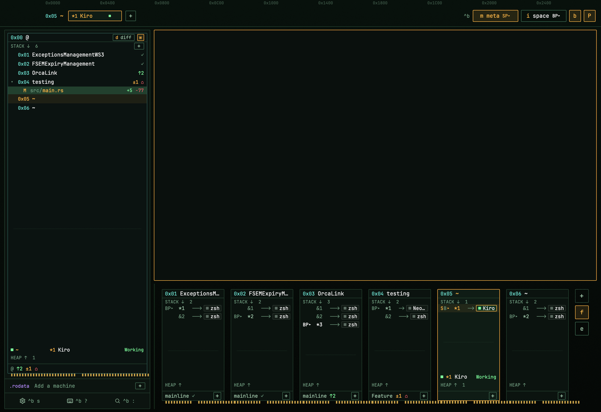

# RAM

A Herdr layout for working on many projects at once. Each space is one project
(a repo with its agents and terminals), drawn as a stick of RAM, and all of them
fit on one screen. You see which agents are working, which need you, what's
running and what changed in each repo without opening anything.



## Two levels, two pointers

Press `ctrl-b` and then the level's key, or click its button on the strip at
the top. Each level keeps its own place, the way a stack keeps two pointers,
and switching takes you back to it.

- **meta** (`^b m`), above, at **SP▸** (amber): every space as a stick below
  your terminal. A stick shows the space's tabs, its agents and running
  commands (green working, red needs you, a cyan `+n` for what finished while
  you weren't looking) and its git branch. The `@` stick on the left lists
  every space with the files changed in each. Click a stick or a tab and the
  terminal shows it; you stay in meta. SP marks that tab: it's the pointer
  that jumps.
- **space** (`^b i`), at **BP▸** (white): the space you work in, at its work
  tab, with its stack of tabs, heap of agents and commands, other machines,
  git, its reviews (HUNK) and its repo's languages (LANG, below). Each space
  keeps its own BP, and it stays where you left it. A strip under the
  terminal shows SP's tab.

For example: you work in api `&2` and watch an agent in testing `*1` from
meta. `^b i` takes you back to api `&2`, and `^b m` to testing `*1`.

lazygit, rg-fzf and hunk open in tabs of their own, the `ctrl-b` key bar works
in every layout, and an optional Neovim theme follows the layout.

## What's in it

| Path | What it is |
|---|---|
| `layouts/ram.json`, `layouts/ram.svg` | the layout, and the picture Settings shows for it |
| `themes/ram.json` | phosphor green on near-black, amber for the current thing |
| `mods/ram/` | the layout's mod: the strip, the side column, the sticks, the peek strip, HUNK, LANG and GIT's dialog |
| `mods/ram-menu/` | the terminals' right-click menu: Copy and Paste, then Herdr's own items |
| `mods/ram-prefix/` | the `ctrl-b` key bar, in every layout (with `^b w` navigate mode, `^b g` lazygit and `^b /` rg-fzf) |
| `mods/ram-text-bigger/`, `mods/ram-text-smaller/` | ⌘+ and ⌘−: the terminals' text a size bigger or smaller |
| `keys.json` | only the keys RAM needs; they go next to yours |
| `nvim/` | optional: the `herdr-ram` colorscheme and the switch that follows the layout (LazyVim) |
| `tests/` | `verify.mjs`, checks that need no Herdr window, and `mutate.py` |
| `preview.png` | a picture of the meta level (the gallery shows it) |
| `RECIPE.md` | the brief to build RAM from scratch; your agent reads it when it adds RAM |

## Needs

- The [Herdr app](https://herdr.dev) 0.1.15 or later, with its herdr-core.
  Tested on 0.1.15 on macOS.
- git. [lazygit](https://github.com/jesseduffield/lazygit) for `^b g` and the GIT
  lines, [hunk](https://hunk.dev) for the reviews (`^b r`, HUNK):
  `brew install lazygit hunk`.
- [rg-fzf](https://github.com/officialparacite/rg-fzf) for `^b /` and the space
  level's `rg-fzf` button (it needs rg, fzf, bat and jq).
- Optional: Neovim with LazyVim for the theme.

## Install

In a Herdr terminal, ask your agent:

> Read ~/.config/herdr-app/AGENTS.md, then add this layout: https://github.com/officialparacite/herdr-ram

It reads every file first, tells you what RAM runs (git, hunk, `hc`), adds the
layout and its mods next to yours, and merges RAM's keys into your
`keys.json`, asking before it replaces a key you already use. Your own layout
and keys stay as they are; `ctrl-shift-l`, or `ctrl-b` then `space`, switches
between layouts.

What the keys take over, so you can say no to any of them:

- `ctrl-b` opens the key bar. Programs no longer get it directly (it moves back
  a character in a shell, a page up in less and vim); `ctrl-b` `ctrl-b` sends it
  to them.
- ⌘+ (`cmd-=`, `cmd-+`) and ⌘− (`cmd--`) change the terminals' text size
  instead of zooming the whole window; `ctrl-b +` and `ctrl-b _` still zoom. On
  Linux ⌘ is the Super key, which many desktops use themselves.
- The keys after `ctrl-b` only apply while the bar is open, so they never
  clash with yours.

### By hand

From a clone of this repo. The mods go in before the keys: Herdr drops a key
whose mod isn't there yet when it loads `keys.json`. Each mod folder is copied
next to `mods/` and then moved in whole, because Herdr docks a mod folder it
sees without its `mod.json` into the layout on screen.

```sh
H=~/.config/herdr-app
cp layouts/ram.json layouts/ram.svg "$H/layouts/"
cp themes/ram.json "$H/themes/"
mkdir -p "$H/.incoming"
for m in ram ram-menu ram-prefix ram-text-bigger ram-text-smaller; do
  cp -R "mods/$m" "$H/.incoming/" && mv "$H/.incoming/$m" "$H/mods/$m"
done
rmdir "$H/.incoming"
for m in ram ram-menu ram-prefix ram-text-bigger ram-text-smaller; do herdr-app check "$H/mods/$m"; done
# Merge RAM's keys into yours; a key you already use keeps yours (it says which).
cp "$H/keys.json" "$H/keys.json.bak-$(date +%Y%m%d%H%M%S)"
python3 - "$H/keys.json" keys.json <<'EOF'
import json, sys
mine_path, ours_path = sys.argv[1], sys.argv[2]
mine = json.load(open(mine_path))
for section, keys in json.load(open(ours_path)).items():
    have = mine.setdefault(section, {})
    for key, action in keys.items():
        if key in have and have[key] != action:
            print(f"kept yours: {section} {key} = {have[key]} (RAM's: {action})")
        else:
            have[key] = action
open(mine_path, "w").write(json.dumps(mine, indent=2, ensure_ascii=True) + "\n")
EOF
herdr-app do layout.switch '{"name":"ram"}'
```

If it keeps your `ctrl-b`, open the bar with a key of your own:
`"<key>": "mod.open:ram-prefix"` in your `global` section. RAM shows whichever
key opens it.

## The levels

| Level | The terminal | The side column | Under the terminal |
|---|---|---|---|
| meta (`^b m`) | on top, at SP | the main stick `0x00 @`: every space's changed files and every agent and command, `d diff` for diffs and a commit box | every space as a stick: its tabs (frames, with the pointers' marks), agents and commands (heap), git line |
| space (`^b i`) | the most room, at the bright BP | STACK (every space), HEAP (this space's agents and commands), `.rodata` (other machines), GIT, HUNK (its reviews), LANG | the peek strip: SP's tab, and under a review where you came from |

The strip on top shows the space you're in, its tabs, the level buttons and
two squares in both levels: `b` shows or hides the side column, `P` the peek
strip. In meta, clicks only select (the terminal shows it, you stay in meta),
and `^b d` switches the main stick between memory and diff.

## SP, BP and RET

- **SP▸** (amber) is the tab meta shows, one across all the sticks. Clicking
  a stick, a tab or an agent in meta moves it, and so do `^b w` and follow.
- **BP▸** is a space's work tab: the one the space level shows in that space.
  Changing tabs in the space level moves it. Every stick has one; the space
  you work in has the bright one (white), the others are dim. `^b I`, or a
  click on the `SP▸` mark, puts the bright BP on SP's tab, to work on what you
  were watching.
- **follow** (`^b f`, or the `f` under the sticks' `+`): when an agent starts
  needing you, SP goes to it. Agents that ask meanwhile wait their turn, the
  longest first, and once you've answered the last one SP goes back where it
  was. Until then a dim **RET▸** marks that tab, like a return address. In
  meta the terminal follows SP; in the space level only SP moves, `m meta`
  turns red and the peek strip shows the agent, so `^b m` opens on it.
- **e** (`^b e`, under `f`): with it on, lazygit, hunk, rg-fzf and `^b I`
  from meta take you into the space level. Off (the default), you stay in
  meta: the tool shows in meta's terminal, and SP goes back when you quit it.

For example: you watch testing `*1` from meta and an agent in web asks for
approval. SP jumps to web and `RET▸` marks testing `*1`. You approve, and SP
is back on testing `*1`.

## HEAP: agents and commands

Every agent shows in its space's HEAP, in every state. So do the commands
running in your tabs' shells (a build, a test run, a dev server, an `ls`), as
soon as they start, with their last line of output:
`&2 Cargo · Running 48 tests · Working`. A command that ends while you aren't
looking at its tab stays there as Done, and its space shows a cyan `+n`, until
you look at that tab. Click a command to peek at its output over the tab
you're on. Editors, pagers, lazygit, top, ssh and REPLs wait for you rather
than work, so they don't show.

## Keys

Press `ctrl-b`, let go, then one key. A bar along the bottom of the window lists
them; Esc, any other key or a click closes it.

| Area | Keys after `ctrl-b` |
|---|---|
| Tabs | `c` new · `C` new… (a terminal or an agent) · `n` / `p` next / previous · `1`…`9` go to · `<` / `>` move left / right · `T` rename · `X` close |
| Spaces | `w` navigate (`j` / `k` spaces, `h` / `l` tabs, `H` `J` `K` `L` panes; Enter stays, Esc goes back) · `N` new · `(` / `)` previous / next · `{` / `}` move up / down · `W` rename · `D` close (asks first) · `G` new worktree |
| Panes | `h` `j` `k` `l` focus · `H` `J` `K` `L` swap · `v` split right · `-` split down · `x` close · `z` zoom |
| Agents | `a` / `A` next / previous |
| Git | `g` lazygit at the repo you're in (a folder that isn't one: a dialog to make it one) |
| Search | `/` rg-fzf at the repo you're in (else its folder) |
| RAM | `m` meta · `i` space · `I` BP here · `f` follow · `e` enter · `P` peek strip · `r` hunk (the space's review, else its menu) · `d` diff (meta's main stick) |
| App | `:` palette · `?` all keys · `s` settings · `b` sidebar · `space` next layout · `+` / `_` / `0` zoom in / out / reset · `ctrl-b` sends `ctrl-b` to the program |

`^b w` is navigate mode, and each move shows at once: `j` and `k` (or up and
down) the next and previous space, `h` and `l` (or left and right) that space's
tabs, round the ends, and `H` `J` `K` `L` the pane that way. Enter, or any other
key, stays where you are; Esc goes back to where you started. RAM shows each
space at its BP and outlines the one it's on in cyan.

`^b h` from the terminal gives RAM's side column the keyboard: ↑ ↓ (or `j`
`k`) move an outline over everything a click reaches, Enter clicks it, `x`
closes, `r` renames, ← → fold a space in the main stick, and Esc goes back to
the terminal. The column's bottom row shows those keys meanwhile. Right-click
a terminal for Copy and Paste, then Herdr's own menu.

Every key is in `keys.json` (`mod:ram-prefix` holds the keys after `ctrl-b`)
and shows in Herdr's keybinds screen, where you can change them.

## LANG: the repo's languages

Under GIT and HUNK in the space level, LANG shows the space's repo by
language, the way GitHub's Languages section does: a bar of each language's
share of the bytes, then the three biggest with their share and file count,
then `+n more`. It counts the files committed at HEAD and finds each one's
language by its extension (or its name, like `Makefile`). Programming and
markup languages count, as on GitHub; vendored and generated files
(`node_modules/`, `vendor/`, lock files, `*.min.js`) never do.

- Click a language for its files, biggest first. Click a file and it opens in
  `$EDITOR` in a new tab.
- Click `LANG` or `+n more` for every language.
- `ext` picks what else counts: data (JSON, YAML...), prose (Markdown, text)
  and extensions RAM doesn't know. Your picks apply to every repo.
- In a short column LANG gives way first (its rows, then all of it), so the
  stack and heap keep room.

## lazygit, rg-fzf and hunk

They open in tabs of their own in the space you work in, one per repo, for the
repo the space is named after (its first terminal's). GIT, HUNK, LANG and each
stick's git line show that repo too, even while another tab is somewhere else.
From meta they show in meta's terminal unless `e` is on.

- `^b g`, or a click on a GIT line, opens lazygit (`lazygit <repo>`). In a
  folder that isn't a repo, a dialog asks what lazygit would: make one there
  (`git init`, with a first branch name or git's default) or open one of
  lazygit's recent repos. Quitting lazygit closes the tab and takes you back.
  In other layouts `^b g` does the same at the focused terminal's repo.
- `^b /`, or the `/ rg-fzf` button at the top of the space level's column,
  opens rg-fzf at the space's repo (no repo: its folder). It works as it does
  on its own: Enter prints the files you picked, `ctrl-o` the lines,
  `alt-enter` JSON, and then the tab is your shell, with that output above the
  prompt. Esc closes the tab and takes you back. In other layouts `^b /` opens
  it at the focused terminal's repo.
- `^b r`, or HUNK's header, opens the space's last review, else a menu:
  `hunk diff` and `diff --staged` (live, `--watch`), `show`, `log`,
  `stash show`, `status`, with an optional ref. HUNK, under GIT, lists the
  space's reviews, one line each (what it shows, its notes `✎n`, how long ago
  it opened): click one to show it, hover for its `✕`, `+` for the menu. A
  plain diff loads the repo's `.hunk/notes.json`. `^b r` on a review takes you
  back and leaves it open, so an agent can read your notes with
  `hunk session`.

## Neovim (optional, LazyVim + aether.nvim)

`nvim/` holds the files for `~/.config/nvim`:

| File | What it does |
|---|---|
| `lua/plugins/herdr.lua` | registers the local theme folder and starts the layout switch |
| `lua/plugins/herdr/colors/herdr.lua` | `herdr`: Herdr's graphite colors, for the `main` layout |
| `lua/plugins/herdr/colors/herdr-ram.lua` | `herdr-ram`: RAM's colors, transparent so the pane shows through (`local transparent = false` for solid) |
| `lua/plugins/herdr/lua/lualine/themes/herdr-ram.lua` | the status bar for `herdr-ram` |
| `lua/config/herdr_theme.lua` | asks `herdr-app status` which layout is shown: `herdr-ram` in RAM, the usual colorscheme otherwise; checks again when nvim gets focus |
| `lua/plugins/colorscheme.lua` | makes `herdr` the usual colorscheme (plain LazyVim only) |
| `lua/plugins/aether.lua` | aether.nvim (v3), which draws both schemes (plain LazyVim only) |

Copy them to the same paths under `~/.config/nvim`, keeping any file of yours
with the same name. On Omarchy, skip `colorscheme.lua` and `aether.lua`. If you
already have `herdr_theme.lua` from another Herdr layout, add
`ram = "herdr-ram",` to its `BY_LAYOUT` instead.

## Tests

```sh
node tests/verify.mjs       # Node 22+
```

They load this repo's mods with a stand-in for Herdr and check what they draw
and run; no window, terminal or network is touched. They read the keys from
this repo's `keys.json`, so a home with keys of its own shows other hints than
they expect. `tests/mutate.py` breaks the code in a copy, one change at a
time, to show the checks notice.

## Removing

```sh
H=~/.config/herdr-app
herdr-app do layout.switch '{"name":"main"}'
rm -rf "$H"/mods/ram "$H"/mods/ram-menu "$H"/mods/ram-prefix "$H"/mods/ram-text-bigger "$H"/mods/ram-text-smaller
rm -rf "$H"/data/ram "$H"/data/ram-menu "$H"/data/ram-prefix "$H"/data/ram-text-bigger "$H"/data/ram-text-smaller
rm -f "$H"/layouts/ram.json "$H"/layouts/ram.svg "$H"/layouts/.state/ram.json "$H"/themes/ram.json
```

Then take RAM's keys out of your `keys.json`: the `mod:ram-prefix` section,
and in `global` the keys bound to `mod.open:ram-prefix`,
`mod.open:ram-text-bigger` and `mod.open:ram-text-smaller`.

## License

Apache 2.0, see [LICENSE](LICENSE). [NOTICE](NOTICE) lists the parts that come
from Night City (MIT), Traveler and Herdr (Apache 2.0) and GitHub Linguist
(MIT).
