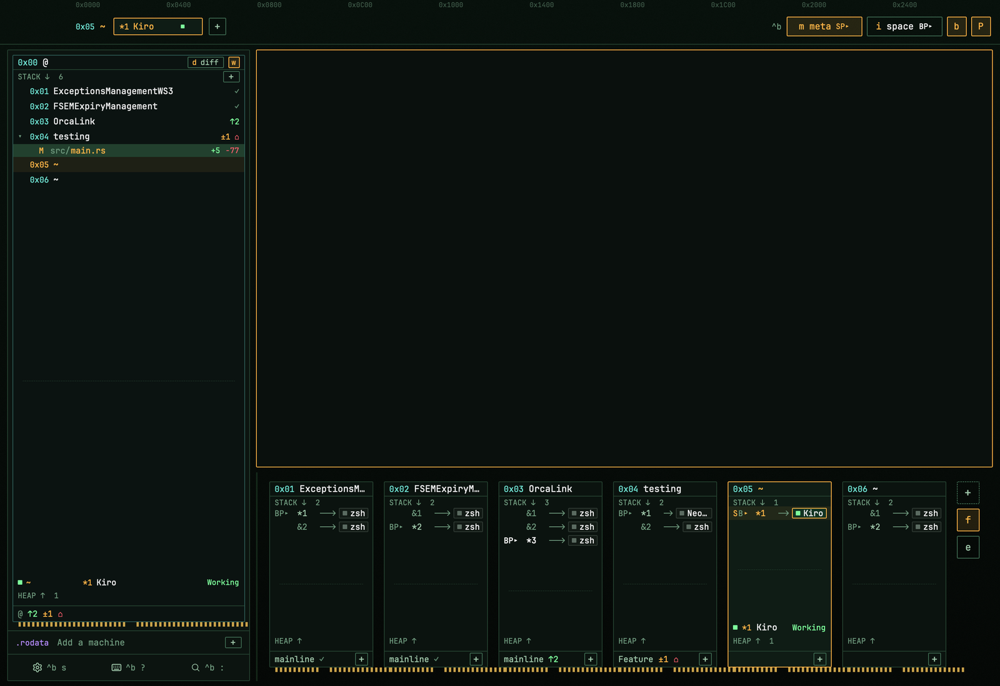

# RAM (private)

The owner's exact setup; the `main` branch is the package to share.

Work on many projects at once and see all of them on one screen. Each space is
one project (a repo with its agents and terminals), drawn as a stick of RAM.
The meta view lines every space up below your terminal, so one glance shows
which agents are working, which need you (in red), what's running and what
changed in each repo. Click a stick to jump to that space; the space view
gives the one you work in the room. Comes with lazygit, hunk, search and
replace, a ctrl-b key bar and a Neovim theme.

**What you see:**

- **Theme `ram`:** background `#0a100d`, canvas `#060a08`, panels `#0b130f`
  and `#0e1712`, borders `#24402f`, text `#c8f7d3`, dim `#6f9a7e`. Amber
  `#ffb547` marks what is current (the space you're in, SP, a lit button),
  white `#ffffff` the bright BP, cyan `#6fe3d3` addresses and what finished
  while you weren't looking, green `#7dff9b` working, red `#ff5f6d` needs you,
  gold `#c9a24a` pins, purple `#b68cff` other machines. JetBrains Mono for
  terminals and panels. Every panel size is `N * U` with `U = 1.25`. No title
  bar; the macOS window buttons sit at 18, 18.
- **The strip, 74px, on top in both levels** (it drags the window): a line of
  small addresses (`0x0000`, `0x0400`, ...), then `0x05 name` for the space
  you're in (cyan address), its tabs as fixed 118x23 chips (`*1` the shown
  tab, `&2` the rest, `!n` when an agent there needs you; long names
  truncate), one square `+`, and on the right `^b`, two fixed 100x26 level
  buttons, `m meta SP▸` and `i space BP▸` (the key in amber, the name, the
  level's pointer: `SP▸` amber, `BP▸` white; the current level lit, meta's red
  and pulsing while SP is on an agent that needs you), and two 26x26 squares
  for the level you're in, `b` (its side column) and `P` (what's under its
  terminal: the sticks in meta, the peek strip in the space level), lit while
  they show. The left 100 points stay clear of the macOS window buttons.
- **The side column** (block `sidebar`) is 390px in meta and 340px in the
  space level. Its edge drags (down to 240px), and each level keeps the width
  you leave it at and whether it shows (`b`, `^b b`).
- **meta:** the terminal on top (two thirds), under it every space as a stick
  (one third, block `ram-rams`, which `P` hides to give the terminal the
  room). A stick: a header (address, name, `◆n` open reviews, `@machine`,
  `FAULT n`, a cyan boxed `+n` for agents and commands that finished unseen),
  `STACK ↓ n`, one frame per tab (its pointers' mark, `*n` where a pointer
  points or `&n`, an arrow, then a block per agent or running command with its
  light and name, sub-agents smaller), free space, the heap (one row per agent
  and running command: light, `&n`, name, what it does or a command's last
  output line, its state) over `HEAP ↑ n`, the git line (`branch ↑2 ↓1 ±3 ⌂`,
  or `✓`, and a `+` for a new tab), and gold pins. The pointers' marks have a
  column of their own: `SP▸` (amber, pulsing) on the one tab meta shows,
  across all the sticks; `BP▸` on each space's work tab, white in the space
  you work in and dim in the others; `RET▸` (dim amber) on follow's return
  address while it's away; two on one tab by their initials (`SB▸`, `BR▸`).
  Sticks share one width, 200x1.25, narrowing to 128x1.25 before the row
  scrolls. Right of the last stick, three 30x1.25 squares, one under the
  other: a dashed `+` (a new space), follow's `f` and `e`, each showing its
  `^b` key, amber while on; the space you're in has an amber outline, another
  machine's a dashed one. The side column is the **main stick** `0x00 @`: its
  STACK is every space with its changed files as a tree (letter, folder/name,
  `+added −removed`, an arrow folds a space, `+` makes a space), its HEAP
  every agent and command of every space (space name first), and its last line
  `@` with every repo's marks added up. `d diff` switches it to the diff view:
  the spaces with changes and their files, the picked file's diff, and a
  commit box for that file's repo. A small `w` box next to `d diff` wraps long
  diff lines to the stick (off: they scroll sideways). Under it `.rodata`
  (other machines, `Add a machine`, `+`) and Settings / Keys / Commands with
  their `^b` keys.
- **space:** the terminal fills the rest. The side column has STACK (every
  space from `0x01` down, a white `◂BP` on the one you work in, `@machine`,
  FAULT, `◆n`, `+n`, and on its label row `^b w`, a `/ search` button drawn as
  meta's `d diff`, and `+` for a new space), HEAP (this space's agents and
  commands, the oldest at the bottom), `.rodata`, GIT (`repo · branch`, marks,
  changed files), HUNK, LANG and the keys row, which never gets cut off; lists
  that don't fit end in `+n more`.
- **The peek strip** (block `ram-peek`, space level only), under the terminal
  and as tall as the side column from the line over `.rodata` down, so its top
  is on that line: a box for SP's tab (`SP▸`, the space and tab, what runs
  there, its state, and as many of its last lines as fit; a red border while
  an agent there needs you), and under a review opened from the space level a
  box for where you came from (`↩`) on its left. No box repeats the tab you're
  on or another box; with nothing to show, or with `P` off, it hides. While
  the side column is hidden it keeps the height it had.
- **HUNK** (space level, with a repo, between GIT and LANG): `HUNK` and how
  many (its `^b r` key where it fits) with a `+`, then one line per review
  RAM opened in this space: `◆` (amber for the one shown), what it shows,
  `✎n` notes, how long ago it opened (`now`, `5m`, `2h`, `3d`) and a hover
  `✕`. Other spaces' reviews aren't listed.
- **LANG** (space level, with a repo, under HUNK): a line `LANG`, `n
  languages` and an `ext` box; a 6x1.25 bar of segments as wide as each
  language's share of the bytes (at least 2 px, 1 px apart, GitHub's colors,
  the darkest lifted 45% toward white so they show on black); then the three
  biggest (a dot, the name, `90.9%`, `2 files`) and `+n more`. In a short
  column its rows give way first, then the whole section, while the stack and
  heap have room for three and two rows. A language opens a 500x420 dialog of
  its files (biggest first, their sizes; a click runs `tab.new` with `exec sh
  -c 'exec "${EDITOR:-vi}" "$1"' sh <path>` at the repo's top); `LANG` and `+n
  more` open the list of every language; `ext` the picker of the repo's data,
  prose and unknown types (a tick each, its extensions, files and size).
- **GIT's dialog** (520x340), for a folder that isn't a repo: `GIT` with the
  space and folder, "isn't in a git repository", a branch name field (its
  hint names git's default, from `git var GIT_DEFAULT_BRANCH`), `Create a repo
  here` and `Open a recent repo ▸` (lazygit's recent repos that still are
  repos, this folder left out), and git's own error when `git init` fails.
- **The search window** (a dialog 0.9 x 0.86 of the window, `popover`
  background): a row with `SEARCH` (cyan; `SEARCH & REPLACE` while replacing),
  the space, a scope button (`Alt-S repo` or `folder`) and the folder, the
  count (`123 lines`, `20,000+ lines` at the cap; `4 matches in 2 files` while
  replacing) and `Alt-/ keys` / `Esc close`; the query box (amber border while
  it types) with `Alt-Up find` while replacing, its mode button
  (`Ctrl-F Content (regex)`, `Content (literal)`, `Content (pcre2)` or
  `Filename (fuzzy)`), an amber cursor and a `✕`; while replacing, a row under
  it: `Alt-Down replace with`, the new text's box and its `✕`,
  `Alt-K keep case`, `Alt-R replace`, `Alt-A replace all` and `Alt-Z undo`;
  the option buttons (`Ctrl-R replace`, `Alt-M match case`,
  `Alt-B whole words`, `Alt-L literal`, `Alt-P pcre2`, `Alt-V invert`,
  `Alt-I hidden`, `Alt-U one per file`, then `Ctrl-P preview`,
  `Alt-W wrap preview`, `Alt-Shift-W wrap list`, `Alt-N numbers`), lit amber
  while on (invert and one per file dim while replacing); the results (a pick
  box, the folder dim and the file's name, `:line:column`, the line without
  its indent and its matches in amber, or while replacing each match struck
  out in red with its new text after it in green; the cursor's row lit) beside
  the preview (55% to start; the divider between them drags from 20% to 80%),
  which shows the file in bat's colors with line numbers, the cursor's line
  lit amber and the list's matches on an amber background; while replacing,
  each line that changes shows twice, struck out on a red tint, then `+` and
  the new line on a green tint; a note row for what a replace did (green,
  amber when it left some alone, red when nothing changed); and the action
  buttons (`Enter files`, `Ctrl-O lines`, `Alt-Enter JSON`, `Alt-C copy`,
  `Ctrl-E edit`, `n picked`, `Tab pick ↓`, `Shift-Tab pick ↑`, `Ctrl-A all`,
  `Ctrl-Z none`), whose place a replace's question takes
  (`Replace 4 matches in 2 files?`, `Enter yes`, `Esc no`). Keys are written
  in words, as rg-fzf's help writes them. Only the rows and lines that fit are
  drawn.
- **The terminal menu** (right-click on a terminal, mod `ram-menu`): Copy and
  Paste, then Herdr's own items (split right and down, zoom, where
  right-clicks go, back to the parent, close pane), each with its key.
- **The key bar:** `ctrl-b` opens a full-width bar on the bottom edge,
  `popover` background, 1px amber top border, a `^b` badge and "then a key ·
  Esc cancels", then the keys grouped as tabs, spaces, panes, agents, git,
  search, RAM (only while RAM shows; its `P` reads `sticks` in meta and `peek`
  in the space level) and app.

**How it behaves:**

- Agent states: working = green light (and a green dot runs along that tab's
  arrow); blocked = red light, a red heap row, `FAULT n` (or `!n`) on its
  stick and chip; done = cyan, a brighter block and heap row in meta and a
  cyan `+n` by its space; idle = dim. A running command is working until it
  ends, then done until you look at its tab. `SP▸` pulses and a faint scan
  line sweeps the sticks; every animation stops while the window isn't
  active.
- The two levels and their places: `^b m` shows meta at SP (again: the space
  level), `^b i` the space level at the bright BP. A level change shows that
  level's place, and nothing is taken for it until that has shown. SP is the
  tab meta shows: clicks in meta, `^b w` there and follow move it. A space's
  BP is the tab the space level shows in it: tab changes in the space level
  move it, and the space you're in there is the one you work in (its BP is the
  bright one). `^b I`, or a click on `SP▸`, moves the bright BP to SP's tab
  (from meta it shows there only with `e` on). A tool's tab (lazygit, a
  review) is never a BP: when it closes, RAM goes back to where you were when
  it showed, in that level.
- Clicking a space, tab, frame, block or agent shows it: in meta that moves
  SP and you stay in meta; in the space level it moves the BP. A space alone
  (a stick's name, a STACK row) shows its BP tab. A running command's row or
  block peeks at its output (`terminal.peek`), over the tab you're on. A
  double-click renames a space or tab, a hover `✕` closes a tab, right-click
  opens Herdr's menu (RAM's own on a terminal), and spaces (same machine) and
  tabs drag to reorder, with a line where they land.
- follow (`^b f` or the `f` square, in both levels): when an agent newly
  needs you, SP goes to the one waiting longest; while SP's agent needs you
  the others wait; once it's answered, SP goes to the next; after the last,
  SP goes straight back to where it was before follow's first move (a dim
  `RET▸` marks it meanwhile), unless that tab closed or you moved SP
  yourself; an agent that asks again gets SP again at once. In meta the
  terminal shows SP; in the space level only SP moves (meta's button turns
  red, the peek strip shows it).
- `e` (`^b e` or its square, off by default): off, a tool opened from meta
  shows in meta's terminal (SP moves onto it and back when you quit it); on,
  the tools and `^b I` from meta go into the space level.
- More keys: `^b r` hunk (the space's last review for its repo, else the menu;
  on a review, back where you came from, and the review stays open), `^b d`
  the main stick's diff view (from the space level: meta with diff; it shows
  meta's side column if you hid it), `^b g` lazygit, `^b /` search, `^b P`
  what's under the terminal off or on (the sticks in meta, the peek strip in
  the space level), `^b b` the side column (each level keeps its own), `^b C`
  the new-tab menu, `^b <` `>` move the tab, `^b {` `}` move the space.
- `^b w` navigate mode, each move shown at once: the bar shows one row
  (`navigate`, the space's name, `@machine`, `i of n`, `tab n` and its name,
  `i of n`); `j`/down and `k`/up the next and previous space, `h`/left and
  `l`/right that space's tabs (round the ends, settled tabs skipped), `H` `J`
  `K` `L` the pane that way (`pane.go`). Enter, any other key or a click
  outside the bar stays; Esc goes back to the space, tab and pane it started
  on (those still there). RAM outlines that space in cyan in every list of
  spaces, and shows each space at its BP.
- The commands in HEAP: a shell's terminal whose foreground program isn't the
  shell runs a command. It shows from the moment RAM sees it (Herdr's
  terminal list, read every second and on every change; quick ones flicker),
  as working with its last output line (`hc read`, every 2 s), and when it
  ends while its tab isn't on screen in an active window, as done with that
  line until you look at its tab or peek. Agents, sub-agents, RAM's tool tabs,
  programs that wait for you (editors, pagers, lazygit, top, ssh, tmux,
  database shells, fzf, hunk, watch) and a bare interpreter (a REPL) aren't
  commands. Commands never take part in follow, faults or `agent.next`.
- Search: `^b /` or the `/ search` button opens the window for the terminal
  you're in (its folder, and its repo's top from
  `git rev-parse --show-toplevel`; with no terminal, the space's repo, and
  picks are copied). Each change of the query or an option starts a run:
  `sh -c` with a script that stops the run before (`kill` on its process
  group) and removes its folder, makes one with `mktemp -d` in `$TMPDIR`, and
  runs ripgrep in the background with rg-fzf's options (`--ignore-case`, or
  `--case-sensitive` with `Alt-M`; the default engine or `--engine pcre2`,
  `--max-columns 500 --max-columns-preview`, `--hidden`, `--invert-match`,
  `--max-count 1`, and `--word-regexp` with `Alt-B`, `--fixed-strings` with
  `Alt-L`; an empty query lists the files with `rg --files`; content mode's
  file name query picks the files searched and filename mode picks the results
  by file name, both with `fzf --filter`), writing 500-line files the window
  reads every 40 ms, up to 20,000 lines. The last results stay until the new
  ones come, and only the newest query runs; until then (after `Alt-S`, say)
  the rows' paths are from the folder they were found in, and Enter, `Ctrl-E`
  and the preview use that folder. The preview runs `bat --line-range` around
  the line. `Alt-Shift-W` wraps the list: a row on as many lines as it needs,
  the cursor's row kept whole on screen. Enter, `Ctrl-O` and `Alt-Enter` put
  the files (once each, sorted, quoted, on one line), the lines
  (`file:line:column:text`) or rg-fzf's JSON (`rg --json` for the whole lines
  and what matched) on the clipboard, focus the terminal you came from and
  paste (`terminal.paste`), then close; paths are relative to that terminal's
  folder when they're under it. `Alt-C` copies instead. `Ctrl-E` or a
  double-click runs `exec sh -c 'exec ${EDITOR:-vim} "+$1" "$2"'` in a new
  tab. Closing stops the run and removes its folder. Each space keeps its
  query and options (`ram.search.last`), and a second `^b /` closes the first
  window (`ram.search.top`). `ram-search` (paths, or a list on stdin) opens
  the window in a tab of its own (`tab.new` with `mod: ram`) for those files,
  and a pick closes that tab.
- Replace (the window's own; the idea is serpl's): `Ctrl-R` turns it on
  (content mode; invert and one per file go off, and their keys say so) and
  off again (the search as it was; the new text stays, and is kept with the
  space's search). Each window opens with it off. While it's on, a run with a
  query is `rg --no-config --json --glob=!.git --replace <new text>` with the
  search's options, its lines kept to `{"type":"match"`: each match comes with
  what ripgrep makes of it (`$1`, `${name}`, `$$`), so ripgrep computes every
  new text. `Alt-Up` and `Alt-Down` choose the field that types. `Alt-K` puts
  each new text in its match's case (all capitals, a capital first, else
  small). `Alt-R` replaces in the picked lines (else the cursor's), `Alt-A` in
  every line listed once the run is done and not cut off at 20,000; only from
  the newest search's rows. `Alt-A` always asks first (in the foot), `Alt-R`
  only outside a repo; Enter says yes, Esc no, other keys do nothing, and any
  other click lets the question go. Each file: never in `.git`, never one
  whose name isn't UTF-8; `readTextFile`, every listed line must still read as
  the JSON's `lines.text` (else the file is left alone: it changed since the
  search), the lines swapped, then `writeTextFile(file, new, old)`, which
  writes only over the text it was given. A file `writeTextFile` can't take
  (over 1 MiB or not UTF-8) goes through a shell script and a plan file (each
  change's line number, the line as found and the new one, escaped) in the
  window's own `mktemp -d` folder: it refuses a file with a NUL (binary, or
  UTF-16, which ripgrep transcodes), swaps only lines that still read as found
  (awk on the bytes, `LC_ALL=C`), adds a last line end only if the file had
  one, keeps the file's mode and writes through its link, keeps a copy for
  undo and moves the new file in after checking `cksum` again. `Alt-Z` puts
  back the last replace's files, each only while it's still what the replace
  wrote (the last 50 replaces). Nothing closes the window while a replace or
  undo runs. The note row says what was replaced and what was left alone, and
  why; the preview reads the files again. It's off for a space on another
  machine (`writeTextFile` writes the files of the computer Herdr runs on).
- lazygit: a GIT line, a stick's git line or `^b g` opens `lazygit <folder>`
  in a tab, one per repo, for the repo the space is named after (the repo top
  of its first terminal's folder; GIT, HUNK, LANG and the stick's git line use
  that one too); quitting it closes the tab and RAM goes back to where you
  came from. A folder that isn't a repo: GIT says "not a repo" and its dialog
  opens instead of lazygit's terminal questions; Create runs `git init` (with
  `--initial-branch=` when a name is typed) and then lazygit, and a recent
  repo opens lazygit there. In other layouts the key bar does the same at the
  focused terminal's repo.
- hunk: the menu offers `diff` and `diff --staged` (both `--watch`), `show`,
  `log`, `stash show` and `status`, with an optional ref. Each review is a tab
  labelled `ram.hunk=<what>`, moved to the end of the space's tabs and kept
  out of the strip and the sticks; a plain diff loads `<repo>/.hunk/notes.json`
  when there is one. HUNK's `✕` asks first when the review has notes.
- The keyboard: `^b h` from the terminal gives the side column the keyboard
  (Herdr's `pane.go` sends it `"focus"`): ↑↓ or `j` `k` move the outline,
  Enter does what a click does, `x` what a `✕` does, `r` renames, ← → fold
  the main stick's spaces, Esc goes back to the terminal (`pane.go right`).
  The strip, the sticks and the peek strip hand the keyboard straight back.
  In LANG's and GIT's dialogs ↑↓ choose, Enter opens, ← or Backspace go
  back, Esc closes.
- The terminal menu's Copy and Paste focus the right-clicked pane
  (`pane.focus`), run `terminal.copy` / `terminal.paste`, then close the menu.
- The diff view's commit box runs `git add -A` and `git commit -m` in the
  picked file's repo, and only when you press Commit.
- ⌘+ / ⌘− change the terminals' text size in settings.json (`font_size`, 1 a
  step, 8 to 32, as Settings does); RAM's panels keep their size.

**Built from:**

- `layouts/ram.json`: column `ram-root` (`titlebar: none`, theme `ram`,
  `terminal_menu: ram-menu`, background gradient `#08110c` to `#050806`, not
  resizable) with block `ram-map` (mod `ram`, 74px, `window_drag`) and row
  `ram-work` (resizable: its 10px gap is the drag handle) holding block
  `sidebar` (mod `ram`, role `side`, min 240) and column `ram-main`:
  `ram-terminals` (`tab: active`, weight 2, cards with a 1px `#24402f` border,
  amber on focus, `lone`), `ram-rams` (role `rams`, weight 1, min 168,
  hidden) and `ram-peek` (role `peek`, 180px until the side column sizes it,
  hidden). `ctrl-b b` toggles `sidebar`.
- `mods/ram/` is one mod in roles: none = the strip, which sizes the blocks
  for the level (`layout.resize`, `layout.show`/`hide`, the peek strip's
  height too), keeps each level's side column shown or hidden (it watches
  `sidebar`'s `hidden` in `layout()`, since `^b b` is Herdr's
  `layout.toggle`), keeps the running commands (`ram.procs`) and follow's
  return address (`ram.ret`), and is the only copy with the command loop
  (`ram.meta|space|hunk|git|rg|follow|enter|bp|peek|changes|zoom|back` from
  `nextCommand()`); `side`; `rams`; `peek`; and the dialogs `hunk-menu`,
  `lang`, `git-init` and `search` (also `ram-search`'s tab). Its mod.json is
  `{"place": "none", "focusable": true}`, so `pane.go` can give a copy the
  keyboard (it gets `"focus"` from `nextCommand()`; the side column keeps it,
  the others hand it back). `main.js` draws the levels; `pointers.js` keeps
  SP, BP and the other places (shared state, since Herdr shows one tab per
  space); `procs.js` the running commands (`terminals()`: a shell whose
  foreground program isn't the shell; their last lines from `hc read`);
  `gitinit.js` GIT's dialog; `search.js` the search window (its run script,
  the preview, the keys, the replace and its two scripts; Tab, Shift-Tab and
  Esc bound with `cx.bind_keys` in its own key context); `ram-search` the
  shell entry for a file list; `all.js` the main stick; `hunk.js` the reviews
  (it runs `hunk session list --json` every 3 s while a review is open, else
  every 15 s); `git.js` branch and counts per space (`git status`,
  `git rev-parse`, `git diff --numstat`, again on `watchFolder` changes and
  every minute); `model.js` the agents and exit history; `ui.js` the colors
  and small parts; `langs.js` LANG: the language table (name, GitHub's color,
  kind, extensions, file names), `git ls-tree -r -l -z --full-tree HEAD` at
  the repo's top on its machine (again when the branch changes and every
  minute), the summary and the dialog (role `lang`, modes `list`, `files`,
  `ext`); `arrow.svg` the frames' arrow head.
- Shared state: `ram.zoom` (meta or not), `ram.sp` (SP: space, tab, pane),
  `ram.bp` (each space's BP tab), `ram.frame` (the space you work in),
  `ram.came` (where you were when a tool's tab showed), `ram.goto` (what the
  next level change shows), `ram.ret` (follow's return address), `ram.enter`
  (`e`), `ram.peek` (the space level's `P`), `ram.sticks` (meta's `P`),
  `ram.peek.h` (the peek strip's height), `ram.procs` (the running commands),
  `ram.side` (dragged widths), `ram.side.hidden` (where you hid the side
  column), `ram.all.mode`, `ram.all.wrap`, `ram.follow`, `ram.opening`,
  `ram.tool.open` (what GIT's dialog picked), `ram.git.again` (a folder git
  init made a repo), `ram.hunk.*`, `ram.lang.include` (what else LANG counts:
  language names and `.ext`s), `ram.search.last` (each space's last search,
  and the window's look and divider), `ram.search.top` (the newest search
  window), and `navigate.space` (`{id, at}`, set by the key bar).
- Commands: `tab.select`, `space.select`, `pane.focus`, `pane.go`, `tab.move`,
  `space.move`, `tab.close`, `tab.rename`, `space.rename`, `space.new`,
  `tab.new` (a language's file, search's editor; GIT's dialog outside RAM),
  `agent.focus`, `terminal.peek`, `terminal.copy`, `terminal.paste`,
  `pane.close`, `layout.resize`, `layout.show`, `layout.hide`,
  `layout.toggle`, `mod.open` (machine-add), `app.settings`, `app.help` and
  `app.palette` (Settings, Keys and Commands); `setAgentOrder()` on every
  render. lazygit and hunk tabs are made with
  `herdr-app do tab.new --space --name --folder --argv '["exec", ...]'` (so
  quitting the program closes its tab), then labelled with `hc label`. It also
  runs `hc machine ls --json` every 15 s, `hc ls --all --json`, `hc read` (the
  peek strip, and the running commands' last lines every 2 s), and for GIT's
  dialog `git var GIT_DEFAULT_BRANCH`, `lazygit --print-config-dir` (then it
  reads lazygit's `state.yml`) and, when you press Create, `git init`. Search
  runs `sh -c` (ripgrep, fzf, awk), `bat`, `rg --json` and `cat`, `kill` and
  `rm` on its own folders in `$TMPDIR`; a replace `readTextFile` and
  `writeTextFile`, and for a big file its own `sh -c` (awk, `cksum`, `cp -p`,
  `mv`). No mod opens a network connection.
- `mods/ram-menu`: the terminals' right-click menu, named by the layout
  root's `terminal_menu`. Herdr opens it as a popup with `{tab: "pane",
  target: {pane, terminal}}` (its mod.json makes it 250x300). Copy and Paste
  run `pane.focus` on that pane (or terminal), then `terminal.copy` /
  `terminal.paste`, then close the menu, since those act on the focused
  terminal; the rest are Herdr's own menu items, each with its key.
- `mods/prefix` + `keys.json` (the bar's name is `NAME` in its main.js and
  `BAR` in `mods/ram/ui.js`): `global` binds `ctrl-b` → `mod.open:prefix` and
  ⌘+/⌘− → `mod.open:text-bigger` / `text-smaller`. The second keys are the
  `mod:prefix` section, each `prefix.<command>[:<first argument>]`; Herdr runs
  a bound key as that binding, so it reaches the bar's `nextCommand()` as its
  action and never its `on_key_down`. The bar runs it once and closes
  (`run(command, {<first arg name from commands()>: value})`, digits become
  numbers). Extras: `prefix.passthrough` (`hc keys <terminal> ctrl+b`),
  `prefix.worktree` (the shipped `worktree` dialog), `prefix.lazygit`
  (`ram.git` in RAM, else a lazygit tab at the focused terminal's repo),
  `prefix.rg` (`ram.rg` in RAM, else RAM's search window, mod `ram` role
  `search`, for the focused terminal), `prefix.newmenu` (the new-tab menu),
  `prefix.tab.left` / `tab.right` and `space.earlier` / `space.later`
  (`tab.move` / `space.move` one place) and `prefix.navigate`, which maps each
  later action back to its key (`j` is `pane.go:down`). A folder that isn't a
  repo gets RAM's GIT dialog (mod `ram`, role `git-init`) from
  `prefix.lazygit` too. In RAM, `space.next` / `space.prev` and navigate show
  a space at its BP (shared `ram.bp`). The bar's overlay is a frameless popup
  whose root is `w_full().h(4000).justify_end()`, so Herdr clips it to the
  window and the bar lands on the bottom edge.
- `mods/text-bigger`, `mods/text-smaller`: empty frameless windows that, on
  open, step `font_size` in settings.json (read, edit, `writeTextFile` with
  the old text, up to 3 tries; a file that doesn't parse is left alone) and
  close.
- `nvim/` (optional): described in README.md.

**Install (for an agent):**

This branch is the owner's exact setup for the owner's own machines (the
`main` branch is the shared package). Here the owner's choice replaces Herdr's
usual rules for someone else's layout: the keymap is replaced, not merged, and
no keybind of the old one is kept; older copies of these mods are replaced,
not renamed. Everything replaced goes first to
`~/.config/herdr-app/.backup-ram-<time>/` (one `<time>` for the whole install,
`date +%Y%m%d%H%M%S`).

1. Read every file first. Tell the person: RAM runs `git` (status, diff) in
   their spaces' repos and, only when they press Commit or Create,
   `git add -A` and `git commit`, or `git init`; it runs `hunk session list`,
   `hc` and `herdr-app do`, and for search ripgrep, fzf and bat (its runs
   write their results to `$TMPDIR`), and reads lazygit's `state.yml`; nothing
   reaches the network.
2. Install the tools and the editor the person picks (Watch out: the tools,
   the editor).
3. Copy `layouts/ram.json`, `layouts/ram.svg` and `themes/ram.json` to the
   same paths in `~/.config/herdr-app`. Then each of `mods/ram`,
   `mods/ram-menu`, `mods/prefix`, `mods/text-bigger` and `mods/text-smaller`:
   copy it next to `mods/` (without `gpui-kit.d.ts`, `herdr.d.ts` and
   `jsconfig.json`), move the old one into the backup, then move the new one
   in whole. Link `~/.config/herdr-app/mods/ram/ram-search` as `ram-search` in
   a folder on the login shell's PATH (`~/.local/bin`).
4. Then replace `keys.json` with this one, the old one into the backup. Off
   macOS, drop its `terminal` key `ctrl-[` (only macOS needs it).
5. With Neovim on LazyVim: copy `nvim/`'s files to the same paths under
   `~/.config/nvim`, keeping any file they change as `<file>.bak-<time>`. On
   Omarchy leave out `lua/plugins/colorscheme.lua` and
   `lua/plugins/aether.lua`, which its theme brings.
6. `herdr-app check` each mod; when they all pass,
   `herdr-app do layout.switch '{"name":"ram"}'`.
7. If `~/.config/herdr-app` is a git repo with an allowlist `.gitignore`, add
   `!/mods/<name>/` for each new mod and commit only the new files.
8. Confirm `herdr-app status` shows no errors with `ram` shown, and that
   `RAM_HOME=~/.config/herdr-app node tests/verify.mjs` passes.

**Watch out:**

- The tools: adding RAM installs everything it uses, so every key works from
  the start. Check what's there first (`command -v`), tell the person what's
  missing and how you'll install it, ask once, then install it the device's
  own way. RAM needs git, lazygit (`^b g`), hunk (`^b r`) and, for search
  (`^b /`), ripgrep, fzf and bat. Homebrew, where there is one, has all of
  them: `brew install git lazygit hunk ripgrep fzf bat`. Without it, hunk
  comes from its installer (`curl -fsSL https://hunk.dev/install.sh | sh`),
  and Debian and Ubuntu call bat `batcat` (link it as `bat`). rg-fzf (and the
  jq it needs) isn't part of RAM any more.
- The editor: LANG and search open files in `$EDITOR`, so ask the person which
  editor they want: Neovim, set up with LazyVim and RAM's theme (`nvim/`), or
  Fresh (https://github.com/sinelaw/fresh), which works like a desktop editor
  and has no learning curve. Install it if it's missing (Homebrew's `neovim`
  or `fresh-editor`; else the system's Neovim package, or Fresh's installer:
  `curl -fsSL https://raw.githubusercontent.com/sinelaw/fresh/refs/heads/master/scripts/install.sh | sh`).
  Make it `EDITOR` in the login shell's startup file, asking first when
  `EDITOR` already names another editor. For Neovim with no `~/.config/nvim`
  yet, start it from LazyVim's starter
  (`git clone https://github.com/LazyVim/starter ~/.config/nvim`, then delete
  its `.git`) before the theme files go in; a config that isn't LazyVim (no
  `lua/config/lazy.lua`) keeps its own look, without RAM's theme files.
- Never test by driving a window someone is using: `^b` keys act on the
  focused pane, tab and space, and RAM's own resizes move their columns.
  `tests/verify.mjs` checks the mods with a stand-in for Herdr instead.
- A key keys.json binds never reaches the focused mod's `on_key_down`; it
  arrives at `nextCommand()` as its action. Esc in a popup is Herdr's
  `overlay.close`, so the bar only gets `close()`.
- `on_size_change` reports screen points; `w()`/`h()` and layout px are
  design px, which the zoom setting scales. Divide by `settings().zoom`.
- Nothing may run past a stick's edge: every row is sized in JS to the
  stick's inner width (monospace text is 0.6 em a character). A frame's arrow
  shortens first (26 down to 12, x1.25), then its blocks narrow to three
  letters, then `+n` counts the rest; FAULT n turns into `!n`, then `@machine`
  goes; heap rows drop the state's word before the name truncates.
- Draw symbols that must line up (the arrow head is `arrow.svg`, centered with
  its line by flex): a glyph placed with absolute offsets sits off the line.
- Rows of a `v_virtual_list` can't take clicks; the main stick's tree is a
  plain scrolling list for that reason. Tooltips must be one line.
- A review's notes live only in the open hunk window, which is why `^b r`
  leaves it open; `exec` in a tab's argv makes quitting the program close the
  tab.
- `image()`/`svg()` paths are relative to the Herdr home: keep `mods/ram/...`.
  `herdr-app check` writes `gpui-kit.d.ts` and `jsconfig.json` into each mod;
  they are ignored here.
- Herdr shows one tab per space, so RAM keeps its pointers itself (`ram.sp`,
  `ram.bp`, shared) and shows a level's own place again when the level
  changes; until that place shows, nothing is taken for it.
- `^b b` and the `b` square are Herdr's `layout.toggle:sidebar`, so RAM learns
  of a show or hide from the layout and keeps it for the level shown. On a
  level change, one it hasn't seen yet belongs to the level being left, and
  RAM's own show or hide for the new level (waited for, up to 2 s) never
  counts as the person's; otherwise one level's setting leaks into the other.
- A hidden block's copy keeps running, timers too: the sticks' copy reads
  nothing while they're hidden, and the side column's doesn't share the peek
  strip's height while it's hidden.
- A command shows once Herdr's terminal list says a shell's foreground
  program isn't the shell, so one that starts and ends between two lists
  never shows. Herdr keeps "done, unseen" only for agents; RAM keeps the
  commands' own (`ram.procs`).
- `terminal.copy` and `terminal.paste` act on the focused terminal, and a
  right-click doesn't focus it: the menu focuses the right-clicked pane first.
- Search: `exec` gives a program's output only when it ends, so results stream
  through files: a run started in the background (every descriptor redirected,
  so `exec` returns at once; Herdr starts it in a session of its own, so
  `kill -- -$$` stops all of it) writes chunk files the window polls. macOS's
  awk cuts a line at its first NUL, so fields are split by `\x1f`. Tab and
  Shift-Tab never reach a mod's `on_key_down` (the UI kit's root takes them to
  move focus): bind them with `cx.bind_keys` in a key context of the window's
  own, on every open (a keys.json reload clears script bindings).
  `readTextFile` refuses text that isn't UTF-8: read such files with `cat`.
- Replace: `writeTextFile` takes at most 1 MiB of UTF-8, on the computer Herdr
  runs on, and `readTextFile` refuses the rest; that's why big and non-UTF-8
  files go through the script. ripgrep's JSON leaves a UTF-8 BOM out of line
  1's `lines.text` and transcodes UTF-16, so keep the BOM and refuse a file
  with a NUL. In tests, `rg --passthru -r` gives a whole file as ripgrep
  replaces it, but adds a line end to a last line that had none. macOS's `tr`
  refuses a file name that isn't UTF-8 unless `LC_ALL=C`.
- Tested on Herdr 0.1.18 on macOS. Re-check after app updates.

**Done when:**

- Every mod passes `herdr-app check`, `node tests/verify.mjs` and
  `node tests/search-e2e.mjs` pass, and `herdr-app status` shows no errors
  with `ram` shown.
- `command -v git lazygit hunk rg fzf bat` finds each one (and `ram-search`
  once it's linked), and `$EDITOR` in a new login shell is the editor the
  person picked (`nvim` or `fresh`).
- `^b m` shows every space as a stick under the terminal with the main stick
  beside it, `SP▸` on the tab meta shows and a `BP▸` on each stick; `^b i`
  gives the terminal the room at the bright BP, with STACK, HEAP, `.rodata`,
  GIT, HUNK and LANG beside it; switching back and forth, each level comes
  back to its own tab.
- In the space level the peek strip shows SP's tab, its top on the line over
  `.rodata`, with as many of its last lines as fit; `P` hides it.
- `^b b` in the space level hides its side column there only: `^b m` still
  shows the main stick, and `^b i` finds it hidden again. `P` in meta hides
  the sticks and gives the terminal their room; `^b d` brings meta's side
  column back.
- With follow on, an agent that asks takes SP there and `RET▸` marks where it
  was; answering takes SP back.
- `^b r` in a repo opens the review menu, then a review in a tab of its own,
  listed under HUNK; `^b r` again goes back.
- `^b g` opens lazygit at the space's repo and quitting it closes its tab; in
  a folder that isn't a repo it opens GIT's dialog, and Create makes it a repo
  and opens lazygit there.
- A command run in a shell tab shows in HEAP while it runs; one that ends in
  another tab stays Done, with a cyan `+1` on its space, until you look at
  that tab.
- In the space level, LANG (under GIT and HUNK) shows the repo's languages
  with the same shares GitHub would give its committed code; `ext` and a tick
  on YAML makes YAML count; a language's file opens in `$EDITOR`.
- `^b /` opens the search window at the space's repo: typing shows the matches
  as they come, the preview shows the file at the line, Enter puts the picked
  files at the prompt of the terminal you came from, and Esc closes it.
- With `Ctrl-R` and a new text, the list strikes each match out with its new
  text after it; `Alt-A` and Enter replace every listed line and the preview
  shows the files as they are now; `Alt-Z` puts them back. `Ctrl-R` again
  turns replace off, and the next `^b /` opens to search.
- `^b w`, `j` shows the next space at once, with a cyan outline on it while
  navigating; `l` shows its next tab, `L` the pane to the right, and Esc goes
  back to where you started.
- `^b h` gives the side column the keyboard: Enter on a row does what its
  click does, and Esc goes back to the terminal.
- Right-clicking a terminal offers Copy and Paste.
- ⌘+ makes the terminals' text bigger and leaves RAM's panels as they were.
- With the nvim files installed, nvim in a RAM pane loads `herdr-ram` with no
  `Normal` background, and the usual colorscheme in any other layout.
