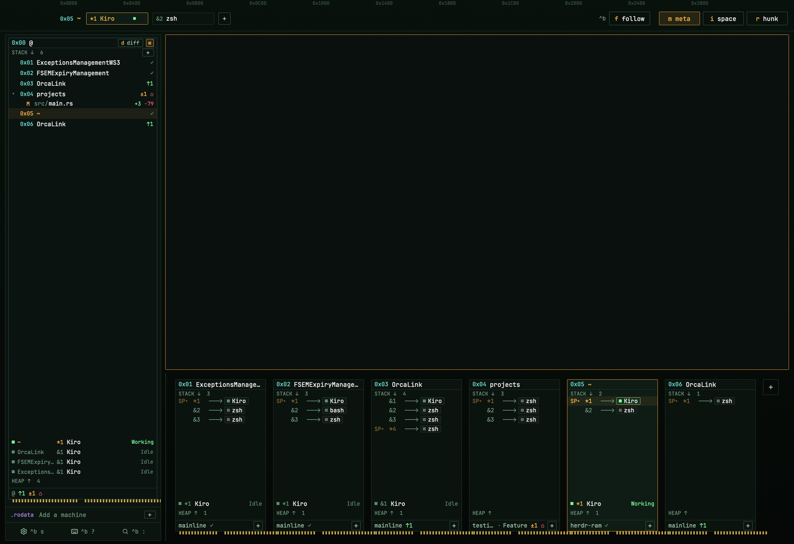

# RAM

Work on many projects at once and see all of them on one screen. Each space is
one project (a repo with its agents and terminals), drawn as a stick of RAM. The
meta view lines every space up below your terminal, so one glance shows which
agents are working, which need you (in red) and what changed in each repo. Click
a stick to jump to that space. Two closer views: space, to work in one, and
hunk, to review its diff. Comes with lazygit, rg-fzf, a ctrl-b key bar and a
Neovim theme.

**What you see:**

- **Theme `ram`:** background `#0a100d`, canvas `#060a08`, panels `#0b130f`
  and `#0e1712`, borders `#24402f`, text `#c8f7d3`, dim `#6f9a7e`. Amber
  `#ffb547` marks what is current (the space you're in, the shown tab, a lit
  button), cyan `#6fe3d3` addresses, green `#7dff9b` working, red `#ff5f6d`
  needs you, gold `#c9a24a` pins, purple `#b68cff` other machines. JetBrains
  Mono for terminals and panels. Every panel size is `N * U` with
  `U = 1.25`. No title bar; the macOS window buttons sit at 18, 18.
- **The strip, 74px, on top in every level** (it drags the window): a line of
  small addresses (`0x0000`, `0x0400`, ...), then `0x05 name` for the space
  you're in (cyan address), its tabs as fixed 118x23 chips (`*1` the shown
  tab, `&2` the rest, `!n` when an agent there needs you; long names
  truncate), one square `+`, and on the right `^b` and fixed level buttons
  `m meta`, `i space`, `r hunk`, each with its key in amber, the current level
  lit. The left 100 points stay clear of the macOS
  window buttons.
- **The side column** (block `sidebar`) is 390px in meta, 340px in space and
  280px in hunk. Its edge drags (down to 240px) and each level keeps the
  width you leave it at.
- **meta:** the terminal on top (two thirds), under it every space as a stick
  (one third, block `ram-rams`). A stick: a header (address, name, `◆n` open
  reviews, `@machine`, `FAULT n`), `STACK ↓ n`, one frame per tab
  (`SP▸` on the tab its space shows, `*n`/`&n`, an arrow, then a block per
  agent with its light and name, sub-agents smaller), free space, the heap
  (one row per agent: light, `&n`, name, what it does, its state) over
  `HEAP ↑ n`, the git line (`branch ↑2 ↓1 ±3 ⌂`, or `✓`, and a `+` for a new
  tab), and gold pins. Sticks share one width, 200x1.25, narrowing to 80%
  before the row scrolls. Right of the last stick, two 30x1.25 squares: a
  dashed `+` (a new space) and under it follow's `f` (its `^b` key), amber
  while follow is on; the space you're in has an amber outline, another
  machine's a dashed one. The side column is the **main stick** `0x00 @`:
  its STACK is every space with its changed files as a tree (letter,
  folder/name, `+added −removed`, an arrow folds a space, `+` makes a space),
  its HEAP every agent of every space (space name first), and its last line
  `@` with every repo's marks added up. `d diff` switches it to the diff view:
  the spaces with changes and their files, the picked file's diff, and a
  commit box for that file's repo. A small `w` box next to `d diff` wraps long
  diff lines to the stick (off: they scroll sideways). Under it `.rodata`
  (other machines, `Add a machine`, `+`) and Settings / Keys / Commands with
  their `^b` keys.
- **space:** the terminal fills the rest. The side column has STACK (every
  space from `0x01` down, `◂SP` on the one you're in, `@machine`, FAULT,
  `◆n`, and on its label row a `/ rg-fzf` button, drawn as meta's `d diff`, then
  `+` for a new space), HEAP (this space's agents, the oldest at the
  bottom), `.rodata`, GIT (`repo · branch`, marks, changed files), LANG and
  the keys row, which never gets cut off; lists that don't fit end in `+n
  more`.
- **LANG** (space level, with a repo): a line `LANG`, `n languages` and an
  `ext` box; a 6x1.25 bar of segments as wide as each language's share of the
  bytes (at least 2 px, 1 px apart, GitHub's colors, the darkest lifted 45%
  toward white so they show on black); then the three biggest (a dot, the
  name, `90.9%`, `2 files`) and `+n more`. In a short column its rows give way
  first, then the whole section, while the stack and heap have room for three
  and two rows. A language opens a 500x420 dialog of its files (biggest first,
  their sizes; a click runs `tab.new` with `exec sh -c 'exec "${EDITOR:-vi}"
  "$1"' sh <path>` at the repo's top); `LANG` and `+n more` open the list of
  every language; `ext` the picker of the repo's data, prose and unknown
  types (a tick each, its extensions, files and size).
- **hunk:** the review fills the terminal block, the side column lists the
  open reviews (the current space's first, `✎n` notes, the id `/hunk` takes,
  a hover `✕`), and a 180px strip under the review shows the last lines of the
  tab you came from (block `ram-peek`).
- **The key bar:** `ctrl-b` opens a full-width bar on the bottom edge,
  `popover` background, 1px amber top border, a `^b` badge and "then a key ·
  Esc cancels", then the keys grouped as tabs, spaces, panes, agents, git,
  levels (only while RAM shows) and app.

**How it behaves:**

- Agent states: working = green light (and a green dot runs along that tab's
  arrow); blocked = red light, a red heap row, `FAULT n` (or `!n`) on its
  stick and chip; done = cyan; idle = dim. `SP▸` pulses on the shown tab of
  the space you're in and a faint scan line sweeps the sticks; every animation
  stops while the window isn't active.
- Clicking a space, tab, frame, block or agent shows it. In meta that only
  selects (the terminal shows it and you stay in meta); elsewhere it goes in.
  A double-click renames a space or tab, a hover `✕` closes a tab, right-click
  opens Herdr's menu, and spaces (same machine) and tabs drag to reorder, with
  a line where they land.
- `^b m` meta (again: back into the space), `^b i` space, `^b r` hunk (the
  space's last review, else the review menu; again: back to your tab, the
  review stays open), `^b f` or the `f` square follow in meta (when an agent
  newly needs you, show the one waiting longest; wait while the shown tab's
  agent needs you; move on once it's answered; never undo a tab you picked;
  once you answer the last one, go straight back to the tab you were on
  before its first move, unless that tab closed or you picked another; an
  agent that asks again is shown again at once), `^b d` the main
  stick's diff view (from another level: meta with diff), `^b g` lazygit,
  `^b /` rg-fzf.
- `^b w` navigate mode, each move shown at once: the bar shows one row
  (`navigate`, the space's name, `@machine`, `i of n`, `tab n` and its name,
  `i of n`); `j`/down and `k`/up the next and previous space, `h`/left and
  `l`/right that space's tabs (round the ends, settled tabs skipped), `H` `J`
  `K` `L` the pane that way (`pane.go`). Enter, any other key or a click
  outside the bar stays; Esc goes back to the space, tab and pane it started
  on (those still there). RAM outlines that space in cyan in every list of
  spaces.
- rg-fzf: the `/ rg-fzf` button or `^b /` opens it in a tab named `rg-fzf` at
  the space's repo (no repo: the shown tab's folder), or shows the one already
  open. The tab runs `sh -c` with a short script: it labels its terminal
  `ram.rg`, runs `out=$(rg-fzf)`, removes the label, closes the tab when
  nothing was printed and rg-fzf exited 0 (Esc), else prints the output and
  `exec`s the user's shell (`$SHELL -il`), so the tab carries on as a plain
  one. While labelled it's a tool's tab (the button lit, its chip cyan, not the
  space's work tab), and when it closes RAM shows the tab you came from.
- lazygit: a GIT line, a stick's git line or `^b g` opens it in a tab at the
  space's repo (the shown tab's folder, else another tab's); quitting it
  closes the tab and RAM shows the tab you came from. No repo: GIT says "not a
  repo" and a toast says why.
- hunk: the menu offers `diff` and `diff --staged` (both `--watch`), `show`,
  `log`, `stash show` and `status`, with an optional ref. Each review is a tab
  labelled `ram.hunk=<what>`, moved to the end of the space's tabs and kept
  out of the strip and the sticks; a plain diff loads `<repo>/.hunk/notes.json`
  when there is one.
- The diff view's commit box runs `git add -A` and `git commit -m` in the
  picked file's repo, and only when you press Commit.
- ⌘+ / ⌘− change the terminals' text size in settings.json (`font_size`, 1 a
  step, 8 to 32, as Settings does); RAM's panels keep their size.

**Built from:**

- `layouts/ram.json`: column `ram-root` (`titlebar: none`, theme `ram`,
  background gradient `#08110c` to `#050806`, not resizable) with block
  `ram-map` (mod `ram`, 74px, `window_drag`) and row `ram-work` (resizable:
  its 10px gap is the drag handle) holding block `sidebar` (mod `ram`, role
  `side`, min 240) and column `ram-main`: `ram-terminals` (`tab: active`,
  weight 2, cards with a 1px `#24402f` border, amber on focus, `lone`),
  `ram-rams` (role `rams`, weight 1, min 168, hidden) and `ram-peek` (role
  `peek`, 180px, hidden). `ctrl-b b` toggles `sidebar`.
- `mods/ram/` is one mod in roles: none = the strip, which sizes the blocks
  for the level (`layout.resize`, `layout.show`/`hide`) and is the only copy
  with the command loop (`ram.meta|space|hunk|git|follow|changes|zoom|back`
  from `nextCommand()`); `side`; `rams`; `peek`; and `hunk-menu` (a dialog).
  `main.js` draws the levels; `all.js` is the main stick; `hunk.js` the
  reviews (it polls `hunk session list --json` once a second while a review is
  open); `git.js` branch and counts per space (`git status`, `git rev-parse`,
  `git diff --numstat`, again on `watchFolder` changes and every minute);
  `model.js` the agents and exit history; `ui.js` the colors and small parts;
  `langs.js` LANG: the language table (name, GitHub's color, kind, extensions,
  file names), `git ls-tree -r -l -z --full-tree HEAD` at the repo's top on its
  machine (again when the branch changes and every minute), the summary and
  the dialog (role `lang`, modes `list`, `files`, `ext`);
  `arrow.svg` the frames' arrow head.
- Shared state: `ram.zoom` (meta or not), `ram.side` (dragged widths),
  `ram.all.mode`, `ram.all.wrap`, `ram.follow`, `ram.from`, `ram.hunk.*`,
  `ram.lang.include` (what else LANG counts: language names and `.ext`s), and
  `navigate.space` (`{id, at}`, set by the key bar).
- Commands: `tab.select`, `space.select`, `tab.move`, `space.move`,
  `tab.close`, `tab.rename`, `space.rename`, `space.new`, `agent.focus`,
  `layout.resize`, `layout.show`, `layout.hide`, `mod.open` (machine-add);
  `setAgentOrder()` on every render. lazygit, rg-fzf and hunk tabs are made
  with `herdr-app do tab.new --space --name --folder --argv '["exec", ...]'`
  (so quitting the program closes its tab), then labelled with `hc label`
  (rg-fzf's script labels its own). It
  also runs `hc machine ls --json` every 15 s, `hc ls --all --json` and
  `hc read` (the peek strip). No mod opens a network connection.
- `mods/ram-prefix` + `keys.json` (the bar's name is `NAME` in its main.js and
  `BAR` in `mods/ram/ui.js`): `keys.json` holds only RAM's keys, merged into
  the person's. `global` binds `ctrl-b` → `mod.open:ram-prefix` and ⌘+/⌘− →
  `mod.open:ram-text-bigger` / `ram-text-smaller`. The keys after `ctrl-b`
  are the `mod:ram-prefix` section, each `ram-prefix.<command>[:<first
  argument>]`; they apply only while the bar is open. Herdr runs a bound key
  as that binding, so it reaches the bar's `nextCommand()` as its action and
  never its `on_key_down`. The bar runs it once and closes
  (`run(command, {<first arg name from commands()>: value})`, digits become
  numbers). Extras: `ram-prefix.passthrough` (`hc keys <terminal> ctrl+b`),
  `ram-prefix.worktree` (the shipped `worktree` dialog), `ram-prefix.lazygit`
  (`ram.git` in RAM, else a lazygit tab at the focused terminal's repo),
  `ram-prefix.rg` (`ram.rg` in RAM, else an rg-fzf tab at that repo or folder,
  with the same script as RAM's, `RG_TAB`) and
  `ram-prefix.navigate`, which maps each later action back to its key (`j` is
  `pane.go:down`). The bar's overlay is a frameless popup whose root is
  `w_full().h(4000).justify_end()`, so Herdr clips it to the window and the
  bar lands on the bottom edge.
- `mods/ram-text-bigger`, `mods/ram-text-smaller`: empty frameless windows
  that, on open, step `font_size` in settings.json (read, edit,
  `writeTextFile` with the old text, up to 3 tries; a file that doesn't parse
  is left alone) and close.
- `nvim/` (optional): described in README.md.

**Watch out:**

- Adding it: RAM runs `git` (status, diff) in the person's repos and, only
  when they press Commit, `git add -A` and `git commit`; it also runs
  `hunk session list`, `hc` and `herdr-app do tab.new`. Nothing reaches the
  network. lazygit and hunk need to be installed for `^b g` and the hunk level,
  and rg-fzf (with rg, fzf, bat, jq) for `^b /`.
- The layout uses its own theme: copy `themes/ram.json` too.
- Copy each mod folder next to `mods/` and move it in whole: Herdr docks a mod
  folder it sees without its `mod.json` into the layout on screen and rewrites
  that layout.
- Put the mods in before merging `keys.json`: Herdr drops a `<mod>.<command>`
  key whose mod folder isn't there when it loads the keys.
- The keys: `ctrl-b` stops reaching programs directly (a shell's back one
  character, less and vim's page up); `ctrl-b` `ctrl-b` sends it. ⌘+/⌘−
  replace Herdr's zoom keys with the terminals' text size (`ctrl-b +`/`_`
  still zoom); on Linux ⌘ is Super, which desktops often use. Ask before
  replacing either. If the person keeps their `ctrl-b`, bind another key to
  `mod.open:ram-prefix`; RAM shows whichever key opens the bar.
- The mod names are prefixed `ram-` so they don't meet another layout's. A
  rename has to change `NAME` in the bar's main.js, `BAR` in
  `mods/ram/ui.js` and every key name in `keys.json`, or the bar loses its
  keys.
- RAM draws in its own colors (`mods/ram/ui.js`), not the person's theme.
- `nvim/` is optional and only for LazyVim: ask first and never overwrite the
  person's files. An existing `herdr_theme.lua` gets `ram = "herdr-ram",` in its
  `BY_LAYOUT`; on Omarchy leave out `colorscheme.lua` and `aether.lua`.
- Never test by driving a window someone is using: `^b` keys act on the
  focused pane, tab and space, and RAM's own resizes move their columns.
  `tests/verify.mjs` checks the mods with a stand-in for Herdr instead.
- A key keys.json binds never reaches the focused mod's `on_key_down`; it
  arrives at `nextCommand()` as its action. Esc in a popup is Herdr's
  `overlay.close`, so the bar only gets `close()`.
- `on_size_change` reports screen points; `w()`/`h()` and layout px are
  design px, which the zoom setting scales. Divide by `settings().zoom`.
- Nothing may run past a stick's edge: every row is sized in JS to the
  stick's inner width (monospace text is 0.6 em a character). A frame's arrow
  shortens first (26 down to 12, x1.25), then its blocks narrow to three
  letters, then `+n` counts the rest; FAULT n turns into `!n`, then `@machine`
  goes; heap rows drop the state's word before the name truncates.
- Draw symbols that must line up (the arrow head is `arrow.svg`, centered with
  its line by flex): a glyph placed with absolute offsets sits off the line.
- Rows of a `v_virtual_list` can't take clicks; the main stick's tree is a
  plain scrolling list for that reason. Tooltips must be one line.
- A review's notes live only in the open hunk window, which is why `^b r`
  leaves it open; `exec` in a tab's argv makes quitting the program close the
  tab.
- `image()`/`svg()` paths are relative to the Herdr home: keep `mods/ram/...`.
  `herdr-app check` writes `gpui-kit.d.ts` and `jsconfig.json` into each mod;
  they are ignored here.
- Tested on Herdr 0.1.14 on macOS. Re-check after app updates.

**Done when:**

- Every mod passes `herdr-app check`, `node tests/verify.mjs` passes, and
  `herdr-app status` shows no errors with `ram` shown.
- `^b m` shows every space as a stick under the terminal with the main stick
  beside it; `^b i` gives the terminal the room with STACK, HEAP, `.rodata`
  and GIT beside it; `^b r` in a repo opens the review menu and a review in a
  tab of its own, and `^b r` again goes back.
- `^b g` opens lazygit at the space's repo and quitting it closes its tab.
- In the space level, LANG under GIT shows the repo's languages with the
  same shares GitHub would give its committed code; `ext` and a tick on YAML
  makes YAML count; a language's file opens in `$EDITOR`.
- `^b /` opens rg-fzf at the space's repo; Enter leaves the picked files
  printed in a shell tab, and Esc closes the tab.
- `^b w`, `j` shows the next space at once, with a cyan outline on it while
  navigating; `l` shows its next tab, `L` the pane to the right, and Esc goes
  back to where you started.
- ⌘+ makes the terminals' text bigger and leaves RAM's panels as they were.
- With the nvim files installed, nvim in a RAM pane loads `herdr-ram` with no
  `Normal` background, and the usual colorscheme in any other layout.
